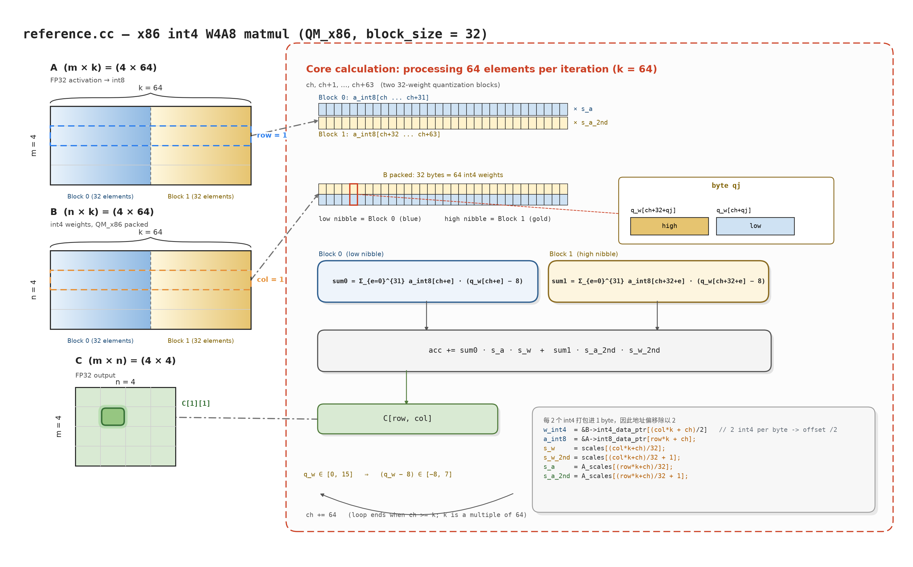
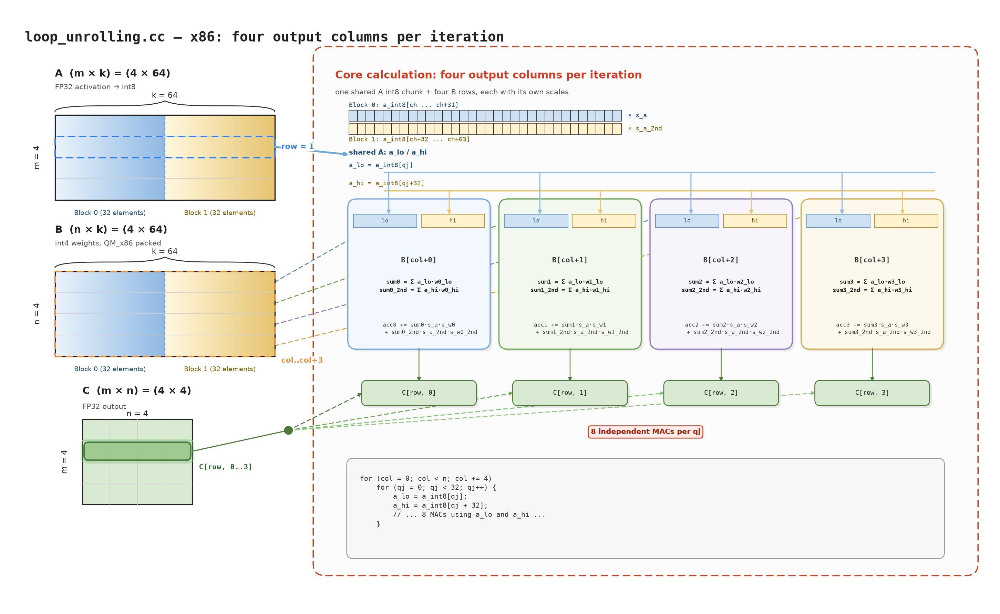
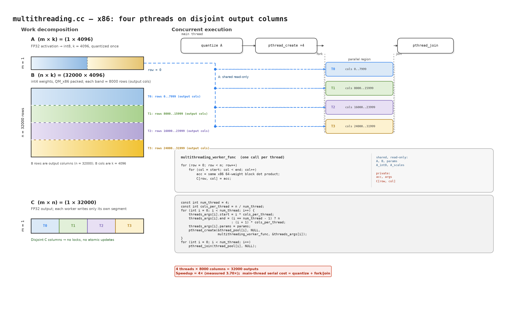
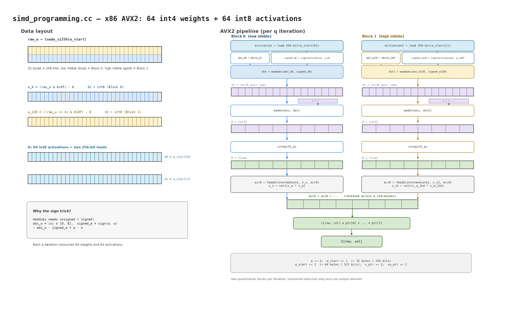

> EfficientML.ai Lab 5 Report
>
> Name: Melody-Zhou


## Reference baseline (x86)

The baseline `reference.cc` computes one output element `C[row, col]` at a time. Activation `A` is quantized to int8 per 32-element block, while the int4 weights `B` are pre-quantized and packed in QM_x86 order. For each 64-weight chunk, the 32 packed bytes hold two 32-weight quantization blocks: the low nibble is a weight from the first block and the high nibble is the corresponding weight from the second block. The two 32-element integer dot products are therefore dequantized with their own activation/weight scales and then accumulated:

```text
acc += sum0 * s_a * s_w + sum1 * s_a_2nd * s_w_2nd
```

The int4 zero point is 8, so a decoded weight is `(q_w - 8) * s_w`. The example uses `m = n = 4` and `k = 64`; the x86 path consumes 64 weights per iteration, so `k` must be a multiple of 64 (the loop ends when `ch >= k`).



*Figure: Reference x86 W4A8 matmul. The highlighted A row and B row produce the highlighted `C[1][1]` element; the 64-weight chunk is split into two 32-weight blocks with separate scales. Generated by [`figures/plot_reference_x86.py`](./figures/plot_reference_x86.py).*

## 1. Loop Unrolling (20pt)

<mark>Please fill in the starter code in</mark> *kernels/starter_code/loop_unrolling.cc* <mark>to implement loop unrolling and run the `./evaluate.sh loop_unrolling` to evaluate performance improvement.</mark>

**a. Implementation (15pt)** — `kernels/starter_code/loop_unrolling.cc`, QM_x86 branch (the ARM branch is unchanged in the file).

```cpp
namespace matmul {
void MatmulOperator::mat_mul_loop_unrolling(struct matmul_params *params) {
    const struct matrix *A = &params->A, *B = &params->B, *C = &params->C;
    const int block_size = params->block_size;  // block_size = 32
    float *scale = params->scales, *offset = params->offset;

    quantize_fp32_to_int8(A->data_ptr, A->int8_data_ptr, params->A_scales, A->row * A->column, block_size);

    int m = C->row, n = C->column, k = A->column;
    // A: m x k; B: n x k; C: m x n
    for (int row = 0; row < m; row++) {
        for (int col = 0; col < n; col += 4) {
            float acc0 = 0;
            float acc1 = 0;
            float acc2 = 0;
            float acc3 = 0;
            // Compute each block
            for (int ch = 0; ch < k;) {
                // pointer of the int8 activation
                const signed char *a_int8 = &A->int8_data_ptr[row * k + ch];
                // pointer of the int4 weights
                uint8_t *w0_int4 = &B->int4_data_ptr[(col * k + ch) / 2];
                uint8_t *w1_int4 = &B->int4_data_ptr[((col + 1) * k + ch) / 2];
                uint8_t *w2_int4 = &B->int4_data_ptr[((col + 2) * k + ch) / 2];
                uint8_t *w3_int4 = &B->int4_data_ptr[((col + 3) * k + ch) / 2];
                // scale of activation
                float s_a = params->A_scales[(row * k + ch) / block_size];
                // scale of weight
                float s_w0 = params->scales[(col * k + ch) / block_size];
                float s_w1 = params->scales[((col + 1) * k + ch) / block_size];
                float s_w2 = params->scales[((col + 2) * k + ch) / block_size];
                float s_w3 = params->scales[((col + 3) * k + ch) / block_size];

                // x86 branch (the ARM branch is unchanged in the file)
#ifdef QM_x86
                // scales of the second block
                float s_w0_2nd = params->scales[(col * k + ch) / block_size + 1];
                float s_w1_2nd = params->scales[((col + 1) * k + ch) / block_size + 1];
                float s_w2_2nd = params->scales[((col + 2) * k + ch) / block_size + 1];
                float s_w3_2nd = params->scales[((col + 3) * k + ch) / block_size + 1];
                float s_a_2nd = params->A_scales[(row * k + ch) / block_size + 1];
                // order of weights with QM_x86:
                // origin order: (w0,w1), (w2,w3), (w4,w5), (w6,w7), (w8, w9), ... (w62,w63)
                // QM_x86 order: (w0,w32),(w1,w33),(w2,w34),(w3,w35),(w4, w36),... (w31,w63)
                //               |--|
                //               4 bits
                //               |------|
                //               8 bits (byte)
                //            low|----------------------------------------------------------|high
                //               0                         256 bit
                // process 32 bytes of weights (256 bit) = 2 blocks for each of unrolled `col`
                // intermediate variable to store sum of integer multiplication and accumulation
                int intermediate_sum0 = 0, intermediate_sum1 = 0, intermediate_sum2 = 0, intermediate_sum3 = 0;
                int intermediate_sum0_2nd = 0, intermediate_sum1_2nd = 0, intermediate_sum2_2nd = 0,
                    intermediate_sum3_2nd = 0;
                for (int qj = 0; qj < 32; qj++) {
                    // TODO: decode a packed byte into two int8 in the range of (-8, 7)
                    // Decode one packed byte for each of the four unrolled columns.
                    // Low nibble  -> Block 0 weight (offset 0)
                    // High nibble -> Block 1 weight (offset +32)
                    const uint8_t packed0 = w0_int4[qj];
                    const uint8_t packed1 = w1_int4[qj];
                    const uint8_t packed2 = w2_int4[qj];
                    const uint8_t packed3 = w3_int4[qj];

                    const signed char w0_lo = (packed0 & 0x0F) - 8;
                    const signed char w0_hi = (packed0 >> 4) - 8;
                    const signed char w1_lo = (packed1 & 0x0F) - 8;
                    const signed char w1_hi = (packed1 >> 4) - 8;
                    const signed char w2_lo = (packed2 & 0x0F) - 8;
                    const signed char w2_hi = (packed2 >> 4) - 8;
                    const signed char w3_lo = (packed3 & 0x0F) - 8;
                    const signed char w3_hi = (packed3 >> 4) - 8;

                    // TODO: int8 multiply and accumulate operation
                    // A is shared by all four output columns.
                    const int a_lo = a_int8[qj];
                    const int a_hi = a_int8[qj + 32];

                    intermediate_sum0 += a_lo * w0_lo;
                    intermediate_sum0_2nd += a_hi * w0_hi;
                    intermediate_sum1 += a_lo * w1_lo;
                    intermediate_sum1_2nd += a_hi * w1_hi;
                    intermediate_sum2 += a_lo * w2_lo;
                    intermediate_sum2_2nd += a_hi * w2_hi;
                    intermediate_sum3 += a_lo * w3_lo;
                    intermediate_sum3_2nd += a_hi * w3_hi;
                }
                // dequantize the sum into floating point
                acc0 += (float)intermediate_sum0 * s_a * s_w0;
                acc0 += (float)intermediate_sum0_2nd * s_a_2nd * s_w0_2nd;
                acc1 += (float)intermediate_sum1 * s_a * s_w1;
                acc1 += (float)intermediate_sum1_2nd * s_a_2nd * s_w1_2nd;
                acc2 += (float)intermediate_sum2 * s_a * s_w2;
                acc2 += (float)intermediate_sum2_2nd * s_a_2nd * s_w2_2nd;
                acc3 += (float)intermediate_sum3 * s_a * s_w3;
                acc3 += (float)intermediate_sum3_2nd * s_a_2nd * s_w3_2nd;
                // process two blocks
                ch += block_size * 2;
#endif
            }
            C->data_ptr[row * n + col] = acc0;
            C->data_ptr[row * n + col + 1] = acc1;
            C->data_ptr[row * n + col + 2] = acc2;
            C->data_ptr[row * n + col + 3] = acc3;
        }
    }
};
}  // namespace matmul
```

**b. Performance comparison (5pt)** — How does the performance in GOPs, achieved through loop unrolling on your computer, compare to the reference implementation? Please explain the performance difference.



*Figure: Four output columns are accumulated in parallel. The shared A operands (`a_lo`, `a_hi`) fan out to all four B blocks; each column has its own packed B row and weight scales, and the inner loop performs eight independent MACs per `qj`. Generated by [`figures/plot_loop_unrolling_x86.py`](./figures/plot_loop_unrolling_x86.py).*

Measured on an Intel Core i7-14700F with g++ 13.3.0, using the lab's default `-O0` build (one representative run; timings vary slightly):

| Implementation | Average time (ms) | GOPs |
|---|---:|---:|
| `reference` | 256.147 | 1.023412 |
| `loop_unrolling` | 116.288 | 2.254260 |

Both implementations pass the `evaluate.sh` sanity check. Loop unrolling improves GOPs by about **2.20×**, and average latency drops by about **54.6%**.

The reference version computes one output column at a time, so each `qj` iteration performs only two MACs and reloads the same A activation for every column. The unrolled version computes four columns (`col..col+3`) together: it loads `a_int8[qj]` and `a_int8[qj+32]` once and reuses them for four packed B rows, producing eight independent MACs per `qj` iteration. This amortizes loop/control overhead over more work and exposes more independent accumulators to the CPU. Since the lab Makefile uses `-O0`, the source-level unrolling is not undone by the compiler; the later multithreading and SIMD versions provide further gains.

## 2. Multithreading (20pt)

<mark>Please fill in the starter code in</mark> *kernels/starter_code/multithreading.cc* <mark>to implement multithreading and run the `./evaluate.sh multithreading` to evaluate performance improvement.</mark>

**a. Implementation (15pt)** — `kernels/starter_code/multithreading.cc`, QM_x86 branch (the ARM branch is unchanged in the file). The worker body is the provided single-thread kernel; the implementation adds column-range partitioning plus the `pthread_create` / `pthread_join` calls.

```cpp
struct multithreading_thread_args {
    int start, end;
    const struct matmul_params* params;
};

static void* multithreading_worker_func(void* args) {
    struct multithreading_thread_args* mat_args = (struct multithreading_thread_args*)args;
    const struct matmul_params* params = mat_args->params;
    const struct matrix *A = &params->A, *B = &params->B, *C = &params->C;
    const int block_size = params->block_size;

    int m = C->row, n = C->column, k = A->column;
    // A: m x k; B: n x k; C: m x n
    for (int row = 0; row < m; row++) {
        for (int col = mat_args->start; col < mat_args->end; col++) {
            float acc = 0;
            for (int ch = 0; ch < k;) {
                uint8_t* w_int4 = &B->int4_data_ptr[(col * k + ch) / 2];
                const signed char* a_int8 = &A->int8_data_ptr[row * k + ch];
                float s_w = params->scales[(col * k + ch) / block_size];
                float s_a = params->A_scales[(row * k + ch) / block_size];
#ifdef QM_x86
                // x86 branch (the ARM branch is unchanged in the file)
                float s_w_2nd = params->scales[(col * k + ch) / block_size + 1];
                float s_a_2nd = params->A_scales[(row * k + ch) / block_size + 1];
                int intermediate_sum = 0, intermediate_sum_2nd = 0;
                for (int qj = 0; qj < 32; qj++) {
                    uint8_t packed_int4_0 = w_int4[qj];
                    signed char w_de_0 = (packed_int4_0 & 0x0F) - 8.0;
                    signed char w_de_16 = (packed_int4_0 >> 4) - 8.0;
                    intermediate_sum += a_int8[qj] * w_de_0;
                    intermediate_sum_2nd += a_int8[qj + 32] * w_de_16;
                }
                acc += (float)intermediate_sum * s_a * s_w;
                acc += (float)intermediate_sum_2nd * s_a_2nd * s_w_2nd;
                ch += block_size * 2;
#endif
            }
            C->data_ptr[row * n + col] = acc;
        }
    }
    return NULL;
}

namespace matmul {
void MatmulOperator::mat_mul_multithreading(struct matmul_params* params) {
    const struct matrix *A = &params->A, *B = &params->B, *C = &params->C;
    const int block_size = params->block_size;

    quantize_fp32_to_int8(A->data_ptr, A->int8_data_ptr, params->A_scales, A->row * A->column, block_size);

    int m = C->row, n = C->column, k = A->column;

    const int num_thread = 4;
    pthread_t thread_pool[num_thread];
    struct multithreading_thread_args threads_args[num_thread];

    // Split the output columns across the worker threads. Each worker scans
    // all rows but only computes the columns in [start, end).
    const int cols_per_thread = n / num_thread;
    for (int i = 0; i < num_thread; i++) {
        threads_args[i].start = i * cols_per_thread;
        threads_args[i].end = (i == num_thread - 1) ? n : (i + 1) * cols_per_thread;
        threads_args[i].params = params;
        int ret = pthread_create(&thread_pool[i], NULL, multithreading_worker_func, &threads_args[i]);
        assert(ret == 0);
        (void)ret;
    }

    for (int i = 0; i < num_thread; i++) {
        int ret = pthread_join(thread_pool[i], NULL);
        assert(ret == 0);
        (void)ret;
    }
};
}  // namespace matmul
```

**b. Performance comparison (5pt)** — How does the performance in GOPs, achieved through multithreading on your computer, compare to the reference implementation? Please explain the performance difference.



*Figure: B has 32000 rows (the output-column dimension `n`), split into four contiguous ranges of 8000 rows. Each worker owns one set of B rows and writes one disjoint segment of C, while the quantized A row and its scales are shared read-only. The main thread quantizes A once, creates four workers, and joins them. Generated by [`figures/plot_multithreading_x86.py`](./figures/plot_multithreading_x86.py).*

Measured on the same Intel Core i7-14700F with g++ 13.3.0 and the default `-O0` build:

| Implementation | Average time (ms) | GOPs |
|---|---:|---:|
| `reference` | 256.147 | 1.023412 |
| `multithreading` | 69.254 | 3.785232 |

Both implementations pass the `evaluate.sh` sanity check. The 4-thread version improves GOPs by about **3.70×** and reduces average latency by about **73.0%**.

The test computes `m = 1`, `n = 32000`, `k = 4096`. B is stored as `n × k`, so its 32000 **rows** are the output columns; the work is split into four contiguous ranges of 8000 B rows (output columns). Each worker owns a disjoint set of output columns (and the corresponding B rows), so the threads write different parts of `C`, read disjoint B slices, and share only the read-only activation buffer and quantization scales. Therefore no locking is needed inside the worker. Activation quantization is performed once on the main thread before the workers start, and the four kernels run concurrently until `pthread_join`.

The speedup is slightly below the ideal 4× because the serial quantization and thread create/join add Amdahl overhead, all four threads compete for the shared memory hierarchy and the CPU's available execution resources, and the `-O0` worker still spends time on scalar address arithmetic and int4 unpacking. On the i7-14700F, four runnable threads may also be placed on a mix of P-cores and E-cores rather than four identical cores.


## 3. SIMD Programming (20pt)

<mark>Please fill in the starter code in</mark> *kernels/starter_code/simd_programming.cc* <mark>to implement SIMD programming and run the `./evaluate.sh simd_programming` to evaluate the performance improvement.</mark>

**a. Implementation (15pt)** — `kernels/starter_code/simd_programming.cc`, QM_x86 branch (the ARM/NEON branch is unchanged in the file). The x86 path uses AVX2 256-bit intrinsics, with one output element `C[row, col]` computed at a time.

```cpp
namespace matmul {
void MatmulOperator::mat_mul_simd_programming(struct matmul_params *params) {
    const struct matrix *A = &params->A, *B = &params->B, *C = &params->C;
    const int block_size = params->block_size;  // block_size = 32

    quantize_fp32_to_int8(A->data_ptr, A->int8_data_ptr, params->A_scales, A->row * A->column, block_size);

    int m = C->row, n = C->column, k = A->column;
    // A: m x k; B: n x k; C: m x n
    for (int row = 0; row < m; row++) {
        for (int col = 0; col < n; col++) {
#ifdef QM_x86
            // order of weights with QM_x86:
            // origin order: (w0,w1), (w2,w3), (w4,w5), (w6,w7), (w8, w9), ... (w62,w63)
            // QM_x86 order: (w0,w32),(w1,w33),(w2,w34),(w3,w35),(w4, w36),... (w31,w63)
            //               |--|
            //               4 bits
            //               |------|
            //               8 bits (byte)
            //            low|----------------------------------------------------------|high
            //               0                         256 bit
            __m256 acc0 = _mm256_setzero_ps();
            // pointer of the int4 weights
            const __m256i *w_start = (__m256i *)&B->int4_data_ptr[col * k / 2];
            // pointer of the int8 activation
            const __m256i *a_start = (__m256i *)&A->int8_data_ptr[row * k];
            // scale of weight
            float *s_ptr = &params->scales[col * k / 32];
            // scale of activation
            float *sa_ptr = &params->A_scales[row * k / 32];

            const int num_block = k / block_size;
            // Compute two blocks in each iteration
            for (int q = 0; q < num_block; q += 2) {
                // lowbit mask
                const __m256i lowMask = _mm256_set1_epi8(0xF);

                // TODO: Unpack 64 4-bit (one __mm256i) weights into 64 8-bit (two __mm256i)
                // (1) load 256 bit from w_start with _mm256_loadu_si256
                // (2) use `_mm256_and_si256` and lowMask to extract the lower half of weights
                // (3) use `_mm256_srli_epi16` and `_mm256_and_si256` with lowMask to extract the upper half of weights
                __m256i raw_w = _mm256_loadu_si256(w_start);

                // TODO: apply zero_point to weights and convert the range from (0, 15) to (-8, 7)
                // Hint: using `_mm256_sub_epi8` to the lower-half and upper-half vectors of weights
                // Note: Store the lower half and upper half of weights into `w_0` and `w_128`, respectively
                const __m256i zero_point = _mm256_set1_epi8(8);
                __m256i w_0, w_128;
                // Low nibble = Block 0 weights; high nibble = Block 1 weights.
                w_0 = _mm256_sub_epi8(_mm256_and_si256(raw_w, lowMask), zero_point);
                w_128 = _mm256_sub_epi8(
                    _mm256_and_si256(_mm256_srli_epi16(raw_w, 4), lowMask), zero_point);

                // Perform int8 dot product with _mm256_maddubs_epi16
                // To utilize _mm256_maddubs_epi16 which only takes unsigned s1, we need to:
                // (1) Get the absolute values of weights (for both lower and upper halves)
                // (2) Change the sign of activation (a0-a31 and a32-a63) depending on the sign of corresponding weights
                // (3) Perform dot product with _mm256_maddubs_epi16 and store the lower
                // and upper halves sum in `dot` and `dot2`
                __m256i dot, dot2;
                // Get absolute values of x vectors
                const __m256i ax = _mm256_sign_epi8(w_0, w_0);
                const __m256i ax2 = _mm256_sign_epi8(w_128, w_128);
                // Load activation
                __m256i activation = a_start[0];
                __m256i activation2 = a_start[1];
                // Sign the values of the y vectors
                const __m256i sy = _mm256_sign_epi8(activation, w_0);
                const __m256i sy2 = _mm256_sign_epi8(activation2, w_128);

                // TODO: Perform int8 dot product with `_mm256_maddubs_epi16`
                // Hint: use `_mm256_maddubs_epi16` to complete the following computation
                // dot = ax * sy
                // dot2 = ax2 * sy2
                dot = _mm256_maddubs_epi16(ax, sy);
                dot2 = _mm256_maddubs_epi16(ax2, sy2);

                // Convert int32 vectors to floating point vectors
                const __m256i ones = _mm256_set1_epi16(1);
                const __m256i summed_pairs = _mm256_madd_epi16(ones, dot);
                const __m256i summed_pairs2 = _mm256_madd_epi16(ones, dot2);
                __m256 intermediate = _mm256_cvtepi32_ps(summed_pairs);
                __m256 intermediate2 = _mm256_cvtepi32_ps(summed_pairs2);

                // Create vectors for scales and apply them to intermediate results
                __m256 v_s = _mm256_set1_ps(s_ptr[0] * sa_ptr[0]);
                __m256 v_s2 = _mm256_set1_ps(s_ptr[1] * sa_ptr[1]);
                acc0 = _mm256_fmadd_ps(intermediate, v_s, acc0);
                acc0 = _mm256_fmadd_ps(intermediate2, v_s2, acc0);
                s_ptr += 2;
                sa_ptr += 2;
                w_start += 1;
                a_start += 2;
            }
            float *ptr = (float *)&acc0;
            C->data_ptr[row * n + col] = ptr[0] + ptr[1] + ptr[2] + ptr[3] + ptr[4] + ptr[5] + ptr[6] + ptr[7];
#endif
        }
    }
};
}  // namespace matmul
```

**b. Performance comparison (5pt)** — How does the performance in GOPs, achieved through SIMD programming on your computer, compare to the reference implementation? Please explain the performance difference.



*Figure: AVX2 data layout and per-iteration pipeline. Each 256-bit packed B load supplies 64 int4 weights; low/high nibbles become `w_0` and `w_128`, while two 256-bit activation loads supply `a0` and `a1`. The `maddubs` + `madd` sequence reduces 32 byte products per vector into eight int32 lanes, then converts to float and accumulates with the block scale. Generated by [`figures/plot_simd_x86.py`](./figures/plot_simd_x86.py).*

Measured on the same Intel Core i7-14700F with g++ 13.3.0 and the default `-O0` build (`-mavx2 -mfma -ffast-math -fpermissive -DQM_x86`):

| Implementation | Average time (ms) | GOPs |
|---|---:|---:|
| `reference` | 256.147 | 1.023412 |
| `simd_programming` | 103.220 | 2.539653 |

Both implementations pass the `evaluate.sh` sanity check. SIMD programming improves GOPs by about **2.48×** and reduces average latency by about **59.7%**.

The x86 kernel processes 32 int8 elements per 256-bit register. For each pair of quantization blocks (`q += 2`), one 256-bit load contains 32 packed bytes, i.e. 64 int4 weights. The low nibbles and high nibbles are separated into `w_0` and `w_128`, the zero point 8 is applied, and two 256-bit activation loads (`a0`, `a1`) provide the corresponding int8 values. Because `maddubs` requires an unsigned first operand, the kernel uses the identity `|w| · sign(a, w) = a · w`; the resulting 16-bit pair sums are combined by `madd` with ones into eight int32 lanes, converted to float, scaled by `s_a * s_w`, and accumulated into `acc0` with FMA. A final horizontal sum produces `C[row, col]`.

The speedup is below 8× because the kernel still computes only one output column at a time: the same A activation is reloaded for every `col`, each output performs a horizontal reduction, and the scalar scale loads and address arithmetic are not vectorized. At `-O0`, the compiler also leaves much of the surrounding loop overhead in place. SIMD is slightly faster than the scalar loop-unrolling version (103.2 ms vs 116.3 ms) but slower than four-thread multithreading (69.3 ms), since it exposes data-level parallelism within one output rather than using multiple cores.


## 4. Multithreading with Loop Unrolling (20pt)

<mark>Please fill in the starter code in</mark> *kernels/starter_code/multithreading_loop_unrolling.cc* <mark>to implement multithreading and loop unrolling and run the `./evaluate.sh multithreading_loop_unrolling` to evaluate the performance improvement.</mark>

**a. Implementation (15pt)** — `kernels/starter_code/multithreading_loop_unrolling.cc`, QM_x86 branch (the ARM branch is unchanged in the file). This is the composition of the loop-unrolled worker from Section 1 and the column-range pthread split from Section 2: each worker computes four adjacent output columns at a time, and four workers own disjoint column ranges.

```cpp
struct multithreading_loop_unrolling_thread_args {
    int start, end;
    const struct matmul_params *params;
};

static void *multithreading_loop_unrolling_worker_func(void *args) {
    struct multithreading_loop_unrolling_thread_args *mat_args =
        (struct multithreading_loop_unrolling_thread_args *)args;
    const struct matmul_params *params = mat_args->params;
    const struct matrix *A = &params->A, *B = &params->B, *C = &params->C;
    const int block_size = params->block_size;

    int m = C->row, n = C->column, k = A->column;
    // A: m x k; B: n x k; C: m x n
    for (int row = 0; row < m; row++) {
        for (int col = mat_args->start; col < mat_args->end; col += 4) {
            float acc0 = 0, acc1 = 0, acc2 = 0, acc3 = 0;
            for (int ch = 0; ch < k;) {
                const signed char *a_int8 = &A->int8_data_ptr[row * k + ch];
                uint8_t *w0_int4 = &B->int4_data_ptr[(col * k + ch) / 2];
                uint8_t *w1_int4 = &B->int4_data_ptr[((col + 1) * k + ch) / 2];
                uint8_t *w2_int4 = &B->int4_data_ptr[((col + 2) * k + ch) / 2];
                uint8_t *w3_int4 = &B->int4_data_ptr[((col + 3) * k + ch) / 2];

                float s_a = params->A_scales[(row * k + ch) / block_size];
                float s_w0 = params->scales[(col * k + ch) / block_size];
                float s_w1 = params->scales[((col + 1) * k + ch) / block_size];
                float s_w2 = params->scales[((col + 2) * k + ch) / block_size];
                float s_w3 = params->scales[((col + 3) * k + ch) / block_size];
#ifdef QM_x86
                // x86 branch (the ARM branch is unchanged in the file)
                float s_w0_2nd = params->scales[(col * k + ch) / block_size + 1];
                float s_w1_2nd = params->scales[((col + 1) * k + ch) / block_size + 1];
                float s_w2_2nd = params->scales[((col + 2) * k + ch) / block_size + 1];
                float s_w3_2nd = params->scales[((col + 3) * k + ch) / block_size + 1];
                float s_a_2nd = params->A_scales[(row * k + ch) / block_size + 1];

                int intermediate_sum0 = 0, intermediate_sum1 = 0, intermediate_sum2 = 0, intermediate_sum3 = 0;
                int intermediate_sum0_2nd = 0, intermediate_sum1_2nd = 0, intermediate_sum2_2nd = 0,
                    intermediate_sum3_2nd = 0;

                for (int qj = 0; qj < 32; qj++) {
                    // Decode one packed byte for each of the four unrolled columns.
                    const uint8_t packed0 = w0_int4[qj];
                    const uint8_t packed1 = w1_int4[qj];
                    const uint8_t packed2 = w2_int4[qj];
                    const uint8_t packed3 = w3_int4[qj];

                    const signed char w0_lo = (packed0 & 0x0F) - 8;
                    const signed char w0_hi = (packed0 >> 4) - 8;
                    const signed char w1_lo = (packed1 & 0x0F) - 8;
                    const signed char w1_hi = (packed1 >> 4) - 8;
                    const signed char w2_lo = (packed2 & 0x0F) - 8;
                    const signed char w2_hi = (packed2 >> 4) - 8;
                    const signed char w3_lo = (packed3 & 0x0F) - 8;
                    const signed char w3_hi = (packed3 >> 4) - 8;

                    // A is shared by all four output columns.
                    const int a_lo = a_int8[qj];
                    const int a_hi = a_int8[qj + 32];

                    intermediate_sum0 += a_lo * w0_lo;
                    intermediate_sum0_2nd += a_hi * w0_hi;
                    intermediate_sum1 += a_lo * w1_lo;
                    intermediate_sum1_2nd += a_hi * w1_hi;
                    intermediate_sum2 += a_lo * w2_lo;
                    intermediate_sum2_2nd += a_hi * w2_hi;
                    intermediate_sum3 += a_lo * w3_lo;
                    intermediate_sum3_2nd += a_hi * w3_hi;
                }

                acc0 += (float)intermediate_sum0 * s_a * s_w0;
                acc0 += (float)intermediate_sum0_2nd * s_a_2nd * s_w0_2nd;
                acc1 += (float)intermediate_sum1 * s_a * s_w1;
                acc1 += (float)intermediate_sum1_2nd * s_a_2nd * s_w1_2nd;
                acc2 += (float)intermediate_sum2 * s_a * s_w2;
                acc2 += (float)intermediate_sum2_2nd * s_a_2nd * s_w2_2nd;
                acc3 += (float)intermediate_sum3 * s_a * s_w3;
                acc3 += (float)intermediate_sum3_2nd * s_a_2nd * s_w3_2nd;
                ch += block_size * 2;
#endif
            }
            C->data_ptr[row * n + col] = acc0;
            C->data_ptr[row * n + col + 1] = acc1;
            C->data_ptr[row * n + col + 2] = acc2;
            C->data_ptr[row * n + col + 3] = acc3;
        }
    }
    return NULL;
}

namespace matmul {
void MatmulOperator::mat_mul_multithreading_loop_unrolling(struct matmul_params *params) {
    const struct matrix *A = &params->A, *B = &params->B, *C = &params->C;
    const int block_size = params->block_size;
    assert(params->block_size % 32 == 0);
    assert(A->row == C->row);

    quantize_fp32_to_int8(A->data_ptr, A->int8_data_ptr, params->A_scales, A->row * A->column, block_size);

    int m = C->row, n = C->column, k = A->column;

    const int num_thread = 4;
    pthread_t thread_pool[num_thread];
    struct multithreading_loop_unrolling_thread_args threads_args[num_thread];
    assert(params->block_size == 32);

    // Each worker advances by four columns, so keep every range aligned.
    const int cols_per_thread = n / num_thread;
    assert(cols_per_thread % 4 == 0);
    for (int i = 0; i < num_thread; i++) {
        threads_args[i].start = i * cols_per_thread;
        threads_args[i].end = (i == num_thread - 1) ? n : (i + 1) * cols_per_thread;
        threads_args[i].params = params;
        assert(threads_args[i].start % 4 == 0 && threads_args[i].end % 4 == 0);
        int ret = pthread_create(&thread_pool[i], NULL, multithreading_loop_unrolling_worker_func,
                                 &threads_args[i]);
        assert(ret == 0);
        (void)ret;
    }

    for (int i = 0; i < num_thread; i++) {
        int ret = pthread_join(thread_pool[i], NULL);
        assert(ret == 0);
        (void)ret;
    }
};
}  // namespace matmul
```

**b. Performance comparison (5pt)** — How does the performance in GOPs, achieved through multithreading and loop unrolling on your computer, compare to the reference implementation? Please explain the performance difference.

The worker reuses the four-column/two-block inner loop from Section 1, while the launcher uses the four-thread column partition from Section 2. No new figure is needed: the core calculation is the loop-unrolling diagram in Section 1, and the execution split is the pthread layout in Section 2.

Measured on the same Intel Core i7-14700F with g++ 13.3.0 and the default `-O0` build:

| Implementation | Average time (ms) | GOPs |
|---|---:|---:|
| `reference` | 256.147 | 1.023412 |
| `multithreading` | 69.254 | 3.785232 |
| `loop_unrolling` | 116.288 | 2.254260 |
| `multithreading_loop_unrolling` | 35.433 | 7.398155 |

Both implementations pass the `evaluate.sh` sanity check. Combining the two optimizations improves GOPs by about **7.23×** over the reference and reduces average latency by about **86.2%**.

The two effects are close to multiplicative: loop unrolling alone is 2.20× and multithreading alone is 3.70×; their product is about 8.15×, while the measured combined speedup is 7.23×. Each worker keeps the four unrolled accumulators and the shared A operands, so it gets the instruction-level parallelism and reduced loop overhead of Section 1. At the same time, four workers process disjoint 8000-column ranges, so the work is distributed across cores without locks. The gap from the ideal product comes from the serial activation quantization, pthread create/join overhead, memory-bandwidth contention between the four workers, and the fixed `-O0` scalar code; the combined kernel is also limited by the cores' sustained throughput rather than by arithmetic count alone.


## 5. Combination of All Techniques (20pt)

<mark>Please fill in the starter code in</mark> *kernels/starter_code/all_techniques.cc* <mark>to implement all techniques above and run the `./evaluate.sh all_techniques` to evaluate the performance improvement.</mark>

**a. Implementation (15pt)** — `kernels/starter_code/all_techniques.cc`, QM_x86 branch (the ARM branch is unchanged in the file). This version combines eight worker threads, AVX2 int8 dot products, and four-block q-loop unrolling: each worker owns a contiguous column range and processes 128 int4 weights per iteration.

```cpp
struct w4a8_thread_args {
    int start_j, end_j;
    const struct matmul_params *params;
};

static void *all_techniques_worker_func(void *args) {
    struct w4a8_thread_args *mat_args = (struct w4a8_thread_args *)args;
    const struct matmul_params *params = mat_args->params;
    const struct matrix *A = &params->A, *B = &params->B, *C = &params->C;
    int n = params->C.column, m = params->C.row, k = params->A.column, block_size = params->block_size;
    const int num_block = k / block_size;  // block_size = 32

    for (int row = 0; row < m; row++) {
        for (int col = mat_args->start_j; col < mat_args->end_j; col++) {
#ifdef QM_x86
            __m256 accumulator = _mm256_setzero_ps();
            float *s_ptr = &params->scales[col * k / 32];
            float *sa_ptr = &params->A_scales[row * k / 32];
            const __m256i *w_start = (__m256i *)&B->int4_data_ptr[col * k / 2];
            const __m256i *a_start = (__m256i *)&A->int8_data_ptr[row * k];
            const int num_block = k / block_size;

            // Four blocks = 128 int4 weights per iteration.
            for (int q = 0; q < num_block; q += 4) {
                const __m256i lowMask = _mm256_set1_epi8(0xF);

                // TODO: Unpack 128 4-bit (two __mm256i) weights into 128 8-bit (four __mm256i)
                // (1) load 256 bit from w_start with _mm256_loadu_si256
                // (2) use _mm256_and_si256 and lowMask to extract the lower half of weights
                // (3) use _mm256_srli_epi16 and _mm256_and_si256 with lowMask to extract the upper half of weights
                __m256i raw_w = _mm256_loadu_si256(w_start);
                __m256i raw_w_next = _mm256_loadu_si256(w_start + 1);

                // TODO: apply zero_point to weights and convert the range from (0, 15) to (-8, 7)
                // Note: For the first two blocks, store the lower half and upper half of weights into `w_0` and
                // `w_128`, respectively For the last two blocks store the lower half and upper half of weights into
                // `w_0_next` and `w_128_next`, respectively
                const __m256i zero_point = _mm256_set1_epi8(8);
                __m256i w_0, w_128, w_0_next, w_128_next;
                w_0 = _mm256_sub_epi8(_mm256_and_si256(raw_w, lowMask), zero_point);
                w_128 = _mm256_sub_epi8(
                    _mm256_and_si256(_mm256_srli_epi16(raw_w, 4), lowMask), zero_point);
                w_0_next = _mm256_sub_epi8(_mm256_and_si256(raw_w_next, lowMask), zero_point);
                w_128_next = _mm256_sub_epi8(
                    _mm256_and_si256(_mm256_srli_epi16(raw_w_next, 4), lowMask), zero_point);

                __m256i dot, dot2, dot3, dot4;
                // Get absolute values of x vectors
                const __m256i ax = _mm256_sign_epi8(w_0, w_0);
                const __m256i ax_next = _mm256_sign_epi8(w_0_next, w_0_next);
                const __m256i ax2 = _mm256_sign_epi8(w_128, w_128);
                const __m256i ax2_next = _mm256_sign_epi8(w_128_next, w_128_next);
                // Load activation
                __m256i activation = a_start[0];
                __m256i activation2 = a_start[1];
                __m256i activation_next = a_start[2];
                __m256i activation2_next = a_start[3];
                // Sign the values of the y vectors
                const __m256i sy = _mm256_sign_epi8(activation, w_0);
                const __m256i sy_next = _mm256_sign_epi8(activation_next, w_0_next);
                const __m256i sy2 = _mm256_sign_epi8(activation2, w_128);
                const __m256i sy2_next = _mm256_sign_epi8(activation2_next, w_128_next);

                // TODO: Perform int8 dot product with `_mm256_maddubs_epi16`
                // dot = ax * sy
                // dot2 = ax2 * sy2
                // dot3 = ax_next * sy_next
                // dot4 = ax2_next * sy2_next
                dot = _mm256_maddubs_epi16(ax, sy);
                dot2 = _mm256_maddubs_epi16(ax2, sy2);
                dot3 = _mm256_maddubs_epi16(ax_next, sy_next);
                dot4 = _mm256_maddubs_epi16(ax2_next, sy2_next);

                // Convert int32 vectors to floating point vectors
                const __m256i ones = _mm256_set1_epi16(1);
                const __m256i summed_pairs = _mm256_madd_epi16(ones, dot);
                const __m256i summed_pairs2 = _mm256_madd_epi16(ones, dot2);
                const __m256i summed_pairs3 = _mm256_madd_epi16(ones, dot3);
                const __m256i summed_pairs4 = _mm256_madd_epi16(ones, dot4);
                __m256 intermediate = _mm256_cvtepi32_ps(summed_pairs);
                __m256 intermediate2 = _mm256_cvtepi32_ps(summed_pairs2);
                __m256 intermediate3 = _mm256_cvtepi32_ps(summed_pairs3);
                __m256 intermediate4 = _mm256_cvtepi32_ps(summed_pairs4);

                // Create vectors for scales and apply them to intermediate results
                __m256 v_s = _mm256_set1_ps(s_ptr[0] * sa_ptr[0]);
                __m256 v_s2 = _mm256_set1_ps(s_ptr[1] * sa_ptr[1]);
                __m256 v_s3 = _mm256_set1_ps(s_ptr[2] * sa_ptr[2]);
                __m256 v_s4 = _mm256_set1_ps(s_ptr[3] * sa_ptr[3]);
                accumulator = _mm256_fmadd_ps(intermediate, v_s, accumulator);
                accumulator = _mm256_fmadd_ps(intermediate2, v_s2, accumulator);
                accumulator = _mm256_fmadd_ps(intermediate3, v_s3, accumulator);
                accumulator = _mm256_fmadd_ps(intermediate4, v_s4, accumulator);
                s_ptr += 4;
                sa_ptr += 4;
                w_start += 2;
                a_start += 4;
            }
            float *ptr = (float *)&accumulator;
            C->data_ptr[row * n + col] = ptr[0] + ptr[1] + ptr[2] + ptr[3] + ptr[4] + ptr[5] + ptr[6] + ptr[7];
#endif
        }
    }
    return NULL;
}

namespace matmul {
void MatmulOperator::mat_mul_all_techniques(struct matmul_params *params) {
    int i, j, k;
    const struct matrix *A = &params->A, *B = &params->B, *C = &params->C;
    const int block_size = params->block_size;
    float *scale = params->scales, *offset = params->offset;

    assert(params->block_size % 32 == 0);
    assert(A->row == C->row);

    quantize_fp32_to_int8(A->data_ptr, A->int8_data_ptr, params->A_scales, A->row * A->column, block_size);

    const int num_thread = 8;
    pthread_t thread_pool[num_thread];
    struct w4a8_thread_args threads_args[num_thread];
    assert(params->block_size == 32);

    const int n = C->column;
    const int cols_per_thread = n / num_thread;
    for (i = 0; i < num_thread; i++) {
        threads_args[i].start_j = i * cols_per_thread;
        threads_args[i].end_j = (i == num_thread - 1) ? n : (i + 1) * cols_per_thread;
        threads_args[i].params = params;
        int ret = pthread_create(&thread_pool[i], NULL, all_techniques_worker_func, &threads_args[i]);
        assert(ret == 0);
        (void)ret;
    }

    for (i = 0; i < num_thread; i++) {
        int ret = pthread_join(thread_pool[i], NULL);
        assert(ret == 0);
        (void)ret;
    }
};
}  // namespace matmul
```

**b. Performance comparison (5pt)** — How does the performance in GOPs, achieved through all optimization techniques on your computer, compare to the reference implementation? Please explain the performance difference.

Measured on the same Intel Core i7-14700F with g++ 13.3.0 and the default `-O0` build:

| Implementation | Average time (ms) | GOPs |
|---|---:|---:|
| `reference` | 256.147 | 1.023412 |
| `loop_unrolling` | 116.288 | 2.254260 |
| `multithreading` | 69.254 | 3.785232 |
| `simd_programming` | 103.220 | 2.539653 |
| `multithreading_loop_unrolling` | 35.433 | 7.398155 |
| `all_techniques` | **15.617** | **16.785703** |

The combined implementation improves GOPs by about **16.40×** over the reference and reduces average latency by about **93.9%**.

The test uses `m = 1`, `n = 32000`, `k = 4096`. Eight threads split the output columns into eight ranges of 4000 columns. Inside each worker, the SIMD loop consumes four quantization blocks (128 int4 weights) per `q` iteration: two 256-bit packed loads become four int8 weight vectors (`w_0`, `w_128`, `w_0_next`, `w_128_next`), four activation vectors are loaded, and four independent `maddubs` → `madd` → `cvt` → FMA chains feed the same eight-float accumulator. The four independent chains expose instruction-level parallelism, while the eight threads provide core-level parallelism.

SIMD alone achieves about 2.54 GOPs. With eight threads, ideal scaling would be roughly `2.54 × 8 ≈ 20.3 GOPs`; the measured 16.8 GOPs is about 83% of that ideal, and 2.27× faster than the four-thread multithreading-plus-loop-unrolling version. The remaining gap comes from the serial activation quantization, thread creation and join overhead, memory-bandwidth contention across eight workers, the per-output horizontal reduction, and the unoptimized `-O0` scalar code around the intrinsics. The SIMD flow and per-column layout are the same as in Section 3; the thread-level layout is the same as in Section 2, so no additional diagram is needed here.


<!-- Page 11 -->

## Code submission

Code: also submit the patch for your implementation, generated with `git diff` and named {studentID}-{ISA}.patch, where {ISA} is x86 or ARM.